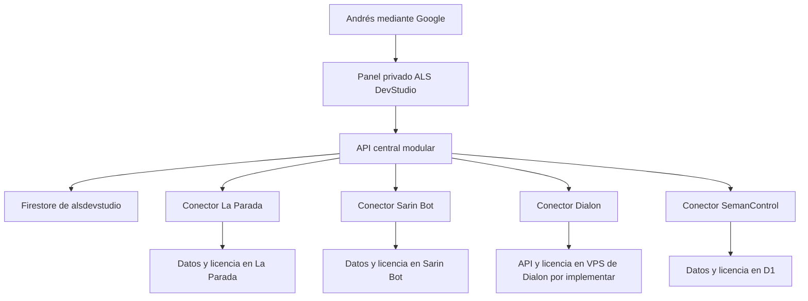

# Panel central de suscripciones de ALS DevStudio

Fecha: 2026-10-14. Estado: diseño propuesto para revisión; alcance comercial confirmado por Andrés.

El panel privado de ALS DevStudio permitirá a Andrés administrar suscripciones, pruebas, vigencias y pagos de sus productos desde un solo lugar. El proyecto Firebase `alsdevstudio` será la autoridad comercial central. Cada aplicación conservará sus usuarios y datos operativos, y aplicará una licencia emitida por el centro mediante un conector de servidor.

## Alcance confirmado

| Producto | Entidad que contrata | Prueba inicial | Integración |
| --- | --- | --- | --- |
| La Parada | Negocio | Siete días | Añadir vigencia SaaS al control de negocios existente |
| Sarin Bot | Negocio | Siete días | Integrar el flujo comercial existente y conservar vigencias |
| Dialon | Persona | Configurable; sin concesión automática hasta definirla | Crear identidad individual y API de licencias en la VPS |
| SemanControl | Negocio | Configurable; sin concesión automática hasta definirla | Conector para D1 y definición del aislamiento empresarial |

El administrador autorizado es `andres.san1404@gmail.com`, mediante Google y Firebase Authentication. Inicialmente registrará pagos ya recibidos por transferencia o Nequi. Cada producto tendrá planes, precios y políticas propios. Las suscripciones de una persona que también administra negocios serán independientes.

El MVP comprende catálogo de productos, sujetos contratantes, suscripciones, pagos manuales, historial de cambios y estado de las conexiones. La conciliación bancaria automática, cobros recurrentes con pasarela y planes de equipo de Dialon quedan para versiones posteriores.

## Situación de las aplicaciones

El sitio público de ALS DevStudio es HTML, CSS y JavaScript modular, publicado en Cloudflare Pages. Su build usa una lista explícita de archivos públicos. El diseño del panel mantendrá esas tecnologías y un despliegue independiente propuesto en `admin.alsdevstudio.com`.

La configuración local de La Parada declara Firebase `laparada-26`. La aplicación usa negocios, roles y estados de acceso. Requiere implementar la prueba y la vigencia SaaS, y revisar todos los caminos de escritura que usan privilegios de servidor.

La configuración local de Sarin Bot declara Firebase `sarinbotsaas`. Ya existen Google Login, superadministración por UID, prueba de siete días, comprobantes y aprobación transaccional. La política actual renueva por 30 días desde el mayor valor entre ahora y el vencimiento existente, y permite una gracia única de 24 horas al subir un comprobante. Sus rutas administrativas actuales autentican al administrador de ese producto; requieren un contrato adicional para el centro.

SemanControl usa Firebase `semancontrolapp` para identidad, Cloudflare D1 para datos y R2 para comprobantes. Su esquema actual representa una sola empresa; no ofrece aislamiento multiempresa. Sus cobros de cartera pertenecen a la operación del negocio, no a la suscripción de SemanControl. Tiene cola, fotos y borradores offline en IndexedDB que deben conservarse.

Dialon tiene su código en [andresleosan/Dialon](https://github.com/andresleosan/Dialon), y Andrés confirma su ubicación en una VPS. La revisión de `main`, commit `7740d9a053db0081a6774af1dd2600f70676121c`, muestra una aplicación Expo en `apps/mobile`, con exportación web, paquetes compartidos de contratos y máquina de turnos. La versión es DEMO: en web captura y reproduce audio local, sin traducción; en nativo la escucha, la traducción y la voz están simuladas. Todavía no implementa cuentas, Firebase, API, base de datos ni suscripciones. La documentación también contempla una exportación de la demo a Cloudflare Pages; esto no sustituye la comprobación posterior de la versión y los procesos que corren en la VPS.

Estas observaciones describen el código local de ALS DevStudio, La Parada, Sarin Bot y SemanControl, y el repositorio GitHub de Dialon. Antes de migrar se comprobarán las versiones desplegadas, las cuentas de facturación y las configuraciones de las consolas y de la VPS.

## Arquitectura propuesta

La API central será un backend modular en Firebase Cloud Functions, con módulos de autorización, suscripciones, pagos y conectores. Cada conector vivirá en el backend de su producto; La Parada, Sarin Bot y SemanControl ya disponen de servidor, mientras que Dialon requiere construir esa capa. Los conectores no necesitan un despliegue adicional separado del backend del producto. El centro guardará los datos comerciales mínimos, sin copiar pedidos, inventario, citas, conversaciones, audios ni cartera.

El panel y su backend tendrán configuraciones y salidas de build separadas del portafolio. El build público actual seguirá excluyendo el panel, las funciones y la documentación. Firebase solo se cargará en la aplicación administrativa; la CSP de la landing conservará su alcance actual.

Se consideran dos alternativas: dar al centro acceso administrativo directo a todas las bases, o migrar todos los datos a una única base. Los conectores reducen la dependencia de los esquemas internos y permiten soportar Firestore, D1 y el futuro almacenamiento del backend de Dialon con el mismo contrato comercial.

## Modelo de datos central

| Colección | Responsabilidad y campos principales |
| --- | --- |
| `products` | Clave estable, nombre, tipo de sujeto permitido, planes y política comercial versionada; referencia del conector, sin secretos |
| `subjects` | Identificador central, `kind: person\|business`, nombre y contacto de facturación mínimo |
| `bindings` | Producto, sujeto, entorno, instancia y referencia local; emisor de identidad e identificador de cuenta o negocio; proyecto Firebase y tenant de Auth cuando se utilicen |
| `subscriptions` | Producto y sujeto, plan contratado, precio y política capturados, fechas de prueba y pago, suspensión, versión deseada y versión confirmada |
| `payments` | Suscripción, importe entero en unidades monetarias menores, moneda, medio, referencia, fecha recibida, confirmación administrativa y período concedido |
| `commands` | Licencia absoluta que debe aplicar un producto, versión, identificador idempotente, intentos y confirmación |
| `auditEvents` | Actor, acción, objetivo, motivo, fecha servidor y valores comerciales antes y después |

Existirá una sola suscripción por `productId + subjectId`, con ID determinista. Reactivar conservará su historial y su prueba consumida. El vínculo local también será único por producto, entorno, instancia y cuenta local, para impedir vincular la misma cuenta a dos sujetos y reiniciar beneficios. Un cambio de propietario conservará la identidad del negocio y su vigencia.

El MVP admitirá un único vínculo operativo de producción por suscripción, validado transaccionalmente. La versión confirmada corresponderá a ese vínculo; las pruebas de integración usarán vínculos de un entorno separado y no contarán como activaciones de producción. Cambiar de instancia exigirá retirar la licencia anterior y confirmar su revocación, o esperar su vencimiento, antes de activar el destino nuevo. El soporte para varios destinos simultáneos requerirá confirmaciones independientes por vínculo en una versión posterior.

Toda identidad local se interpretará junto con su emisor. El UID de Firebase siempre se interpretará dentro de su proyecto y tenant de Authentication. Una coincidencia de correo o de UID entre proyectos no vincula identidades automáticamente. Dialon tendrá un identificador individual estable; su proveedor de identidad se definirá en la especificación de ese producto, sin suponer que Firebase ya esté instalado. Los usuarios de cada negocio seguirán siendo miembros del producto; agregar un empleado no crea una suscripción.

## Reglas de prueba y vigencia

Las pruebas de La Parada y Sarin Bot durarán 168 horas desde un inicio fijado por el servidor. La creación será transaccional y conservará `trialStartedAt` y `trialEndsAt`. La garantía de una sola prueba corresponde a un sujeto identificado dentro de un producto; detectar una reinscripción con otra identidad requiere revisión o identificación adicional.

Dialon y SemanControl tendrán la prueba desactivada inicialmente en el catálogo hasta que Andrés configure una duración. Los precios de los cuatro productos se introducirán desde el panel antes de admitir nuevas suscripciones; un plan sin precio o política válida permanecerá como borrador.

Cada plan distinguirá explícitamente `fixedDays` y `calendarMonth`. Sarin Bot conservará `fixedDays: 30` en sus contratos existentes. Para planes nuevos, la propuesta es mes calendario con ancla de renovación y ajuste al último día cuando el mes no tenga ese día; el período se calculará en `America/Bogota` y se almacenará como instante UTC. El panel mostrará las fechas y el precio antes de confirmar un pago.

Una renovación anticipada comienza al terminar la vigencia existente; una reactivación vencida comienza al confirmar el nuevo período. Un primer pago durante una prueba respeta la vigencia concedida, tomando el mayor valor entre ahora, `trialEndsAt` y `paidUntil`. Las duraciones contractuales históricas se importarán sin recalcularlas.

La suspensión manual tiene prioridad sobre las fechas. Confirmar un pago renueva la vigencia, pero no elimina una suspensión manual: reactivar exige una acción identificada en auditoría. Al vencer, se restringen las operaciones comerciales protegidas; se conservan los datos y las rutas necesarias para conocer el estado, renovar y recuperar información según la política del producto.

Cada servidor y las reglas de datos aplicables comprobarán la licencia y la hora confiable en las operaciones protegidas. Una tarea programada podrá refrescar vistas, pero no será responsable de hacer efectivo el vencimiento. TTL no se utilizará para suspender ni para borrar sujetos vencidos.

La gracia histórica de Sarin Bot se importará con sus límites y su marca de consumo. Su política inicial conservará la gracia única de 24 horas, pero el centro será el único que podrá concederla: el conector notificará la recepción del comprobante y solicitará la gracia de forma idempotente. El centro comprobará elegibilidad y consumo previo, fijará el vencimiento y emitirá la licencia. Si no responde, el comprobante se conservará y la solicitud quedará pendiente; el producto no ampliará el acceso por su cuenta. Registrar un comprobante no equivale a confirmar dinero recibido. Los demás productos comenzarán sin gracia automática salvo configuración explícita de su política versionada.

## Registro de pagos manuales

Andrés seleccionará la suscripción, introducirá importe, medio, referencia, fecha recibida y período contratado. El servidor presentará y validará la nueva vigencia; importes y extensiones requieren confirmación explícita en la interfaz. El registro distinguirá dinero efectivamente recibido de mensualidades esperadas.

La confirmación tendrá una clave idempotente ligada al contenido. En una transacción se guardarán pago, aplicación del período, nueva versión de suscripción, auditoría y comando. Reintentar la misma solicitud devolverá el resultado existente; reutilizar la clave con datos distintos producirá un conflicto. Dos pagos distintos y concurrentes deberán conservar ambas extensiones mediante transacciones.

Las referencias manuales se usarán para alertar de posibles duplicados. Solo se impondrá unicidad bancaria cuando exista un identificador externo verificable y delimitado por su origen. Un comprobante o una referencia escrita a mano no bastan para afirmar que se trata de una transacción única.

Los pagos confirmados no se borrarán. Una corrección generará un ajuste relacionado y auditado, con recálculo transaccional que respete los demás pagos. Los importes parciales o distintos del precio contratado requerirán una decisión visible sobre el período; el servidor no los convertirá silenciosamente en una mensualidad completa.

Los comprobantes de Sarin permanecerán en su almacenamiento actual y podrán consultarse mediante acceso autorizado. El MVP central no copiará imágenes a documentos Firestore ni interpretará comprobantes como confirmación bancaria.

## Contrato de integración y sincronización

Cada conector admitirá registrar o vincular una cuenta, consultar la licencia aplicada y aplicar una licencia emitida por el centro. Los mensajes identificarán `productId`, `subjectId`, `bindingId`, `commandId`, versión y fechas absolutas. No enviarán instrucciones acumulativas como sumar 30 días.

El conector verificará identidad de servicio, producto y cuenta destinataria. Aplicará una versión nueva en una operación atómica, devolverá la versión confirmada e ignorará reintentos ya aplicados. Una versión antigua nunca podrá revivir una licencia suspendida o reemplazar otra más reciente. Para servidores Google se preferirá identidad de servicio e IAM; conectores Cloudflare usarán un mecanismo de autenticación de servidor validado para su runtime, con secretos rotables en el gestor del proveedor y fuera del cliente.

El centro mostrará por separado el estado deseado y la confirmación del producto. Una activación o suspensión sin confirmación aparecerá como pendiente. Ante timeout se reintentará el mismo comando con espera creciente y número de intentos acotado; los fallos persistentes quedarán visibles para reconciliación administrativa. Una consulta de reconciliación permitirá detectar una confirmación perdida después de que el producto aplicó el cambio.

Los productos consultarán su copia local de licencia, protegida contra escrituras del usuario. Una caída central permitirá continuar hasta el vencimiento confirmado; no extenderá pruebas ni activará nuevas cuentas. La primera alta que no consiga licencia conservará el registro pendiente y permitirá reintentar de forma idempotente.

Al conectar Sarin se retirará su autoridad independiente para aprobar renovaciones y conceder gracias; esas acciones se canalizarán por la API central. Esta regla evita que dos administradores o dos interfaces calculen vigencias distintas para el mismo pago o comprobante.

## Acceso exclusivo y protección de datos

El alta administrativa inicial se realizará desde un entorno confiable, verificando correo, proveedor Google y correo confirmado. Se fijará el UID permitido de Andrés y un permiso administrativo asignado mediante Admin SDK. No existirá un flujo público donde el primer usuario se convierta en administrador.

Cada endpoint verificará firma, expiración, proyecto emisor `alsdevstudio`, UID permitido, permiso y estado vigente de autorización. Las operaciones sensibles comprobarán revocación. Firestore denegará por defecto; las escrituras comerciales pasarán por backend. El Admin SDK omite las reglas de Firestore, por lo que el servidor aplicará autorización explícita e IAM mínimo.

Las cuentas de clientes seguirán en el sistema de identidad de sus productos. El token administrativo de `alsdevstudio` no se reutilizará como si fuera un token de `sarinbotsaas`, `laparada-26` o `semancontrolapp`, ni otorgará una cuenta individual en Dialon. La comunicación entre servidores usará su propia identidad y audiencia.

Las otras cuentas Google carecerán de acceso a datos y acciones. El flujo cliente rechazará sesiones no autorizadas. Si además se requiere impedir que Firebase llegue a crear o autenticar esas cuentas, se habilitarán funciones de bloqueo con Identity Platform como decisión adicional; la autorización del panel no dependerá de ese complemento.

La configuración web pública de Firebase puede incluirse en el panel. Las credenciales Admin SDK y secretos de conectores permanecerán en el servidor. Los logs omitirán tokens, comprobantes y datos bancarios; la auditoría conservará solo los campos necesarios. Las consultas y escrituras comprobarán el sujeto y producto autorizado aunque el identificador recibido tenga formato válido.

## Integración individual de Dialon en la VPS

La VPS indicada por Andrés será el destino propuesto de la futura API de Dialon. Su ubicación no exige mover la aplicación ni sus datos a Firebase para administrarla desde ALS DevStudio. La nueva API necesitará sesiones verificables, cuentas individuales estables y almacenamiento durable de la última licencia aplicada. La elección de proveedor de identidad, motor de datos y proceso de despliegue corresponderá a la especificación de integración de Dialon.

El conector recibirá licencias del centro mediante HTTPS y autenticación entre servidores, con las mismas versiones, idempotencia y confirmaciones del contrato común. La cuenta autenticada determinará el sujeto destinatario; no se aceptará un identificador de otro usuario enviado por el cliente. Los usuarios del producto no tendrán acceso al backend administrativo central.

Para el servicio mensual se propone una API de traducción que valide sesión, vigencia, suspensión y límites del plan antes de consumir inferencia. Los límites actuales de audio y turnos son validaciones funcionales locales; no equivalen a control de suscripción. La demo local puede seguir siendo una demostración, pero ocultar botones de Expo no protegerá por sí solo un servicio comercial. La política de prueba de Dialon seguirá sin concesión automática hasta configurar su duración.

El centro recibirá exclusivamente información comercial y el estado necesario para administrar el acceso. Los audios y conversaciones permanecerán en el flujo propio de Dialon. La implementación verificará que una cuenta vencida o suspendida no invoque directamente la traducción protegida y que una caída del centro respete la última vigencia confirmada sin ampliarla.

## Tratamiento de SemanControl y su modo offline

La primera conexión identificará la instancia actual como un negocio. Incorporar más empresas requerirá una instancia y base aisladas por empresa, o un proyecto separado de migración multiempresa con aislamiento en todas las consultas. El centro puede representar ambas modalidades mediante `bindings`; no se habilitarán varias empresas sobre la base global actual.

La integración conservará IndexedDB, fotos, borradores, snapshots y claves de idempotencia. El vencimiento no ejecutará limpieza de cola. Antes de aceptar operaciones sincronizadas, el servidor verificará identidad y licencia; las operaciones pendientes que requieran revisión se conservarán para recuperación administrativa y no se aplicarán confiando solo en la fecha del dispositivo.

El conector de SemanControl tendrá una especificación propia para el tiempo máximo autorizado sin conexión y la conciliación al reconectar. Ese trabajo será requisito para activar su control de vencimiento en producción. Una suspensión inmediata de un dispositivo totalmente desconectado no se puede garantizar; el panel reflejará la confirmación del backend, no una supuesta confirmación de cada dispositivo.

## Experiencia administrativa

La navegación tendrá Resumen, Productos, Suscripciones, Pagos y Actividad. El resumen separará recaudación real, mensualidades previstas, pruebas, próximos vencimientos y conexiones pendientes. Los importes se agruparán por moneda sin sumar monedas diferentes.

Las listas tendrán búsqueda, filtros y paginación. El detalle de suscripción mostrará contratante, producto, plan, precio, vigencia efectiva, historial de pagos y sincronización. Renovar, suspender, reactivar y corregir un pago identificarán claramente el destinatario y el resultado antes de confirmar.

Se reutilizarán tokens de marca y fuentes locales, con foco visible, formularios etiquetados, estados accesibles, movimiento reducido y diseño de 320 a 1440 px. La sesión será necesaria para obtener datos. Un aviso `noscript` explicará que el acceso administrativo requiere JavaScript.

## Entregas y condiciones de conexión

La implementación se dividirá en trabajos revisables: primero núcleo central y panel, después integración de Sarin Bot, luego La Parada, y finalmente Dialon y SemanControl con sus requisitos propios. Esta especificación define el núcleo y el contrato común; cada integración tendrá su plan y validación específicos antes de modificar datos reales.

Para preparar el núcleo se comprobarán la propiedad y configuración real de `alsdevstudio`, proveedor Google, UID administrativo, ubicación de Firestore, facturación y origen autorizado. Los productos se podrán registrar como desconectados mientras se completa su conector. Añadir un producto al catálogo no significará que ya se controla su acceso.

La migración de Sarin incluirá inventario comercial, respaldo verificado, mapeo de negocios y períodos, ensayo con datos sintéticos y comparación de vigencias. Se importarán identificadores históricos para evitar aplicar otra vez pagos antiguos. El cambio de autoridad tendrá una ventana controlada y un procedimiento de reversión; nunca quedarán dos fuentes activas de aprobación. La reversión conservará pagos posteriores y reconciliará las licencias antes de devolver autoridad al flujo anterior.

## Costo previsto

Cloud Functions requiere Blaze y una cuenta de facturación. Para un administrador y aproximadamente 50 a 100 sujetos entre los cuatro productos, con consultas paginadas y licencias locales, la estimación inicial del centro es US$0 a US$5 al mes. Es una estimación de planificación, no una tarifa garantizada; excluye la infraestructura propia de cada producto, imágenes y consumo de APIs de voz o IA.

Se configurarán alertas de facturación, límites de instancias y limpieza de artefactos. Firebase ofrece límites de gasto en Preview para algunos servicios, pero su aplicación puede demorarse y no cubren todo el consumo. La disponibilidad y configuración de estas medidas se comprobarán en la cuenta antes del despliegue.

## Criterios de aceptación

1. Solo el UID administrativo autorizado puede consultar o cambiar los datos del centro, incluidas llamadas directas a la API.
2. El catálogo representa los cuatro productos con el tipo de sujeto confirmado, y distingue conexión pendiente de conexión operativa.
3. Una suscripción individual y una de negocio de la misma persona conservan pagos y permisos separados.
4. Las pruebas de siete días de La Parada y Sarin Bot comienzan con hora servidor y no se reinician al reactivar, cambiar propietario o agregar usuarios.
5. Un pago confirmado se aplica una sola vez; dos pagos distintos concurrentes conservan ambos períodos.
6. La renovación respeta el contrato de 30 días o mes calendario, incluidos cambios de mes y vencimiento anticipado.
7. El navegador no puede modificar vigencias, conceder permisos ni alterar la licencia local mediante acceso directo a la base.
8. Vencimiento y suspensión se hacen efectivos en las operaciones protegidas, con acceso conservado a renovación y recuperación según la política del producto.
9. Una orden repetida o antigua no duplica beneficios ni deshace una suspensión; un timeout aparece pendiente y permite reconciliar.
10. Las vigencias históricas de Sarin se conservan, y la aprobación comercial queda bajo una única autoridad.
11. La futura integración de SemanControl conserva sus pendientes offline y valida su recuperación sin duplicar operaciones ni mezclar empresas.
12. El panel funciona con teclado y en móvil; los cambios se anuncian de forma accesible. El build del portafolio continúa excluyendo los archivos del panel y del backend.
13. Antes de activar la suscripción de Dialon, su backend autentica la cuenta individual y rechaza traducciones protegidas sin licencia vigente, incluidas llamadas directas que omitan la interfaz; el centro no recibe audio.

## Referencias

- [Stack actual de ALS DevStudio](../../../STACK.md) y [build público](../../../.github/cloudflare/build.mjs).
- Sarin Bot: `src/lib/server/businesses.ts`, `billing.ts`, `billing-policy.ts`, `auth.ts`, `src/app/api/admin/route.ts` y `firestore.rules` en el proyecto local `F:/Proyectos/Sarin Bot`.
- La Parada: `src/types/negocio.ts` y `firestore.rules` en `F:/Proyectos/la-parada/Dev`.
- SemanControl: `migrations/0001_init.sql`, `src/lib/auth/principal.ts`, `src/lib/offline/storage.ts` y `queue.ts` en `F:/Proyectos/SemanControl`.
- Dialon: [README](https://github.com/andresleosan/Dialon/blob/7740d9a053db0081a6774af1dd2600f70676121c/README.md), [controlador DEMO](https://github.com/andresleosan/Dialon/blob/7740d9a053db0081a6774af1dd2600f70676121c/apps/mobile/src/useDemoConversation.ts) y [exportación web](https://github.com/andresleosan/Dialon/blob/7740d9a053db0081a6774af1dd2600f70676121c/docs/deploy/cloudflare-pages.md). Ubicación en VPS confirmada por Andrés; procesos desplegados aún por verificar.
- [Permisos administrativos Firebase](https://firebase.google.com/docs/auth/admin/custom-claims), [verificación de tokens](https://firebase.google.com/docs/auth/admin/verify-id-tokens) y [funciones de bloqueo](https://firebase.google.com/docs/auth/extend-with-blocking-functions).
- [Seguridad Firestore](https://firebase.google.com/docs/firestore/security/overview) y [comportamiento de TTL](https://firebase.google.com/docs/firestore/ttl).
- [Planes de Firebase](https://firebase.google.com/docs/projects/billing/firebase-pricing-plans), [tarifas de Firestore](https://firebase.google.com/docs/firestore/pricing) y [límites de gasto](https://firebase.google.com/docs/projects/billing/spend-caps).
